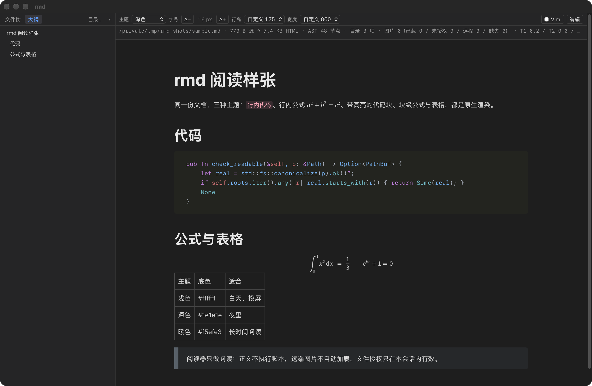
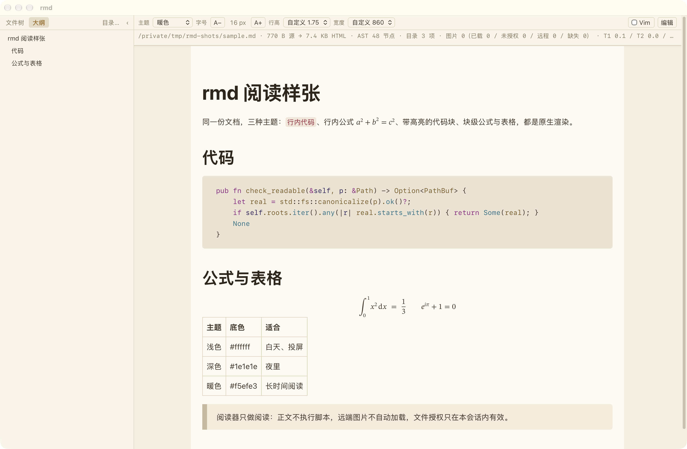

# rmd — a Markdown workspace for reading and editing, built for large documents and folders

Read, search, edit, and export Markdown on macOS — for source repositories, documentation trees, and
long-form text that is slow in a browser tab and unreadable as raw source.

[中文说明](README.zh-CN.md) · [Download](https://github.com/kumustone/rmd/releases/latest) · [Changelog](CHANGELOG.md) · [Build from source](BUILDING.md)

**Requires macOS 13+ on Apple Silicon.**

[](assets/screenshots/theme-light.png)

## Why rmd

**A whole folder is one query away.** Opening a folder builds a single filename index over every
Markdown file below it: 100,000 files in 201 folders index in **122 ms**, and a query that matches
tens of thousands of names still answers in **48–54 ms**. `⌘P` searches that index — you never expand
directories by hand.

**Reading and editing are the same page.** Click a paragraph, list, table cell, or code block and an
editor opens exactly where the block stands; leave it and the page returns. Both states are drawn on
one typographic scale — heading colours, block spacing and list markers come from the same
definitions — instead of a second rendering that approximates the first. In-place editing is opt-in in
this release — see [Enable in-place editing](#enable-in-place-editing).

**Documents are rendered before they reach the page.** Syntax highlighting, math (MathML) and Mermaid
diagrams are produced in Rust, and the generated markup is rebuilt against a whitelist. No script
from a document runs in the webview, and no third-party JavaScript is loaded to draw one.

**Your files stay where they are.** No account, no import step, no sync, no telemetry. Reads follow
the grants you give to a folder or a file, one session at a time.

**Reading is most of the work, so resuming it is one keystroke.** In a codebase, far more time goes
into reading READMEs, design notes, and runbooks than into writing them. rmd turns the empty view into
a page you can act from: `⌘L` returns to it from any document, with new document, open, recent
directories, and favourites on it — each with its shortcut. `⌘D` keeps the document you reopen most
often on that page; closing a document does not lose your place in history.

## Feature list

At a glance: browse and search a folder of Markdown, read it with typography built for long Chinese
and English text, edit it in place or in source, and take the result out as HTML or PDF. The tables
below list what the app does today, including the cases it does not handle.

### Start page

`⌘L` returns to the start page from any document. It is not a placeholder: new document (`⌘N`),
open (`⌘O`), recent directories, and favourites are all on the page, each with its shortcut, so
continuing yesterday's reading takes one key instead of a file dialog. `⌘D` favourites the current
document, and `⌘[` walks back through the documents you were reading.

### Markdown support

| Syntax and rendering | Supported | Notes |
|---|:---:|---|
| CommonMark: headings, emphasis, links, images, lists, blockquotes, rules, code | ✅ | |
| GFM tables | ✅ | `<br>` inside a cell becomes a line break |
| GFM task lists | ✅ | Checkboxes are clickable in the reading view |
| Strikethrough, autolinks, footnotes | ✅ | |
| Fenced code with syntax highlighting | ✅ | Highlighting has a budget; blocks over it are shown as complete plain text and counted in the status bar |
| Math: `$…$` and `$$…$$` | ✅ | Rendered as MathML |
| Mermaid diagrams | ✅ | 12 kinds: flowchart, sequence, class, state, ER, pie, mindmap, journey, gitGraph, timeline, sankey, architecture. Other kinds fall back to a code block with a visible reason |
| Heading anchors and in-document links | ✅ | |
| Relative links to other Markdown files | ✅ | Open in rmd with the same permission checks as the sidebar |
| Image preview and zoom | ✅ | |
| YAML frontmatter | ❌ | Not parsed; shown as document text |
| GitHub alerts (`> [!NOTE]`) | ❌ | Shown as ordinary blockquotes |
| Embedded HTML and scripts | ❌ | Dropped, not executed; `<br>` inside a table cell is the one exception |

### Reading

| Feature | Supported |
|---|:---:|
| Outline view in the sidebar | ✅ |
| Find in the document (`⌘F`, `⌘G` / `⇧⌘G`) | ✅ |
| Reading position remembered per document | ✅ |
| Font size, line height, content width | ✅ |
| Light, dark, warm, and follow-system themes | ✅ |
| Image zoom overlay | ✅ |

### Editing

In-place editing is opt-in in this release; see [Enable in-place editing](#enable-in-place-editing).
Split view works without a flag.

| Capability | In place | Split view |
|---|:---:|:---:|
| Paragraphs, headings, lists, quotes, code blocks | ✅ | ✅ |
| Table cells | ✅ | ✅ |
| Task item checkboxes, clicked to toggle | ✅ | — |
| Floating format bar (headings, links, table rows and columns) | ✅ | — |
| Replace inside the source (`⌥⌘F`) | — | ✅ |
| Vim keybindings | — | ✅ |
| Undo / redo | ✅ | ✅ |
| IME composition stays in place | ✅ | ✅ |
| Save to disk (`⌘S`) | ✅ | ✅ |
| External editor (`⇧⌘E`) and reload on disk change | ✅ | ✅ |

Leaving a block applies the change to the open document; `⌘S` writes it to the file.

- `⌘↵` starts a new paragraph after the block instead of leaving editing. `Tab` / `⇧Tab` nest and
  outdent list items one level at a time, with the subtree following its parent.
- `⌘N` creates an unnamed document immediately and asks for a location on the first save.
- Automatic reload is paused for files whose measured render time is too high; the notice bar then
  offers *Reload now* instead of reloading silently.

### Folders, search, and navigation

| Feature | Supported |
|---|:---:|
| File tree, one directory level at a time | ✅ |
| Flat document list with parent paths | ✅ |
| 5,000-row list cap that reports shown and total counts | ✅ |
| Fuzzy filename search over the whole folder (`⌘P`) | ✅ |
| Persistent search box in the sidebar | ✅ |
| Rebuild the filename index (`⌘R`) | ✅ |
| Dot-files hidden; configurable ignore list | ✅ |
| Folders with no Markdown below them hidden | ✅ |
| Incompletely scanned subtrees kept visible and reported | ✅ |
| Start page with new document, recents, and favourites (`⌘L`) | ✅ |
| Favourite a document or folder (`⌘D`) | ✅ |
| Back and forward through documents (`⌘[` / `⌘]`, mouse side buttons) | ✅ |
| Drop a file or folder on a window to open it | ✅ |
| Reveal in Finder | ✅ |

### Export and macOS integration

| Feature | Supported |
|---|:---:|
| Save as HTML (`⇧⌘S`) | ✅ |
| Export as PDF (`⇧⌘P`) | ✅ |
| Copy as Markdown, HTML, plain text, or rich text | ✅ |
| Paste as literal Markdown (`⇧⌘L`) | ✅ |
| Native window tabs (`⌘T`) and multiple windows (`⇧⌘N`) | ✅ |
| Command-line tool installed from the app (`rmd file.md`, `rmd ./docs`) | ✅ |
| Opening from a terminal or the Dock brings the window forward | ✅ |
| Chinese and English interface | ✅ |

## Install and get started

### Download

Download the `.dmg` from [Releases](https://github.com/kumustone/rmd/releases/latest), then drag
`rmd.app` into `/Applications`. Checksums and version-specific changes are on the same release page.

The build is ad-hoc signed and has not been notarized by Apple. If macOS blocks it, first try opening
the app, then go to **System Settings → Privacy & Security → Open Anyway** and follow the system
prompts. See [Apple's instructions](https://support.apple.com/en-us/102445).

### Browse and read

1. `⌘O` opens the panel (recents first, then browse a folder or a file); `⇧⌘O` goes straight to a
   single Markdown file.
2. Switch the file panel between tree and document list, then use `⌘P` to jump to a file by name.
3. Navigate the document with the outline and `⌘F`.

### Open files from the terminal

Choose **rmd → Install Command Line Tool…** in the app and pick a location:

- `~/.local/bin`: no administrator permission required. If it is not on `PATH`, the app provides
  setup instructions.
- `/usr/local/bin`: requires administrator authorization.

The app checks whether the command is available after installation. It does not modify your shell
configuration; the same menu provides an uninstall action.

```bash
rmd README.md     # open a file
rmd ./docs        # open a folder
```

The command links to the executable inside the app. Replacing the app at the same path keeps the link
working; moving the app requires reinstalling the command.

<details>
<summary>Install the command-line link manually</summary>

This example assumes `/Applications/rmd.app`. Adjust the target if the app is installed elsewhere.

```bash
mkdir -p "$HOME/.local/bin"
ln -s /Applications/rmd.app/Contents/MacOS/rmd "$HOME/.local/bin/rmd"
export PATH="$HOME/.local/bin:$PATH"
```

The `export` applies to the current terminal only. Configure `PATH` for your shell to make it
persistent. If a command already exists at that location, use the app menu to manage it.
</details>

For dependencies, source builds, and app packaging, see [BUILDING.md](BUILDING.md).

## Enable in-place editing

In-place editing is a new input path, so it still ships behind a flag. Add one key to the
configuration file and restart rmd:

```json
{
  "live_edit": true
}
```

The file is `~/Library/Application Support/io.github.kumustone.rmd/config.json`. If it already exists,
add the key to the existing object instead of replacing the file; if it does not exist yet, create it
with the content above. Restart rmd. With the key absent the reading surface is unchanged and `⌘E`
still gives the split view.

## Performance

Measured on an **Apple M2 Pro with 16 GB RAM, macOS 27.0**, using release builds on 2026-10-24. All
figures are medians; every row states its scope, and none of them is a keystroke-to-pixels timing.

| Scenario | Result | Scope |
|---|---:|---|
| Build an index of 100,000 `.md` files in 201 folders | 122 ms | Backend index construction |
| Query an existing 100,000-entry index, high hit rate | 48–54 ms | Backend matching, sorting, and result truncation |
| List 100,000 entries in one folder | 354 ms | Backend scanning, filtering, and sorting |
| Append the first 500 document-list rows | 12–13 ms | Offscreen DOM construction and layout |
| Complete appending 5,000 document-list rows | 113 ms | Offscreen DOM construction and layout |

The first query also pays the index-build cost. These figures exclude IPC, real-window compositing,
and first paint.

Document pipeline, per stage, Rust side only, on ~10.5 MB generated files:

| Stage | Prose | Table-dense |
|---|---:|---:|
| Read from disk and validate UTF-8 | 8.8 ms | 9.6 ms |
| Parse with comrak | 11.0 ms | 109.2 ms |
| Render HTML (highlighting, math, diagrams) | 3.8 ms | 65.7 ms |

Stages are parts of one pipeline, not additive open time: the app's open path also includes IPC,
WebView parsing, layout, and first paint. A code-heavy 10 MB file renders in **402 ms** because
highlighting stops at its budget, not because highlighting became cheap — 2,973 of 25,310 code blocks
are highlighted and the other 22,337 are shown as complete escaped text. Full methodology, all 17 corpus
files, and reproduction steps are in the [performance documentation](assets/performance/).

## Keyboard shortcuts

| Files and windows | Shortcut |
|---|---|
| Open… | `⌘O` |
| Open File… | `⇧⌘O` |
| New File… | `⌘N` |
| Save | `⌘S` |
| Search by File Name… | `⌘P` |
| Refresh File Index | `⌘R` |
| Open in External Editor | `⇧⌘E` |
| Save as HTML… | `⇧⌘S` |
| Export as PDF… | `⇧⌘P` |
| New Window | `⇧⌘N` |
| New Tab | `⌘T` |

| Reading and navigation | Shortcut |
|---|---|
| Go to Start Page | `⌘L` |
| Back / Forward (documents) | `⌘[` / `⌘]` |
| Toggle Favorite | `⌘D` |

| Finding | Shortcut |
|---|---|
| Find… | `⌘F` |
| Find and Replace… | `⌥⌘F` |
| Find Next / Previous | `⌘G` / `⇧⌘G` |

| Editing | Shortcut |
|---|---|
| Toggle Editing (split view) | `⌘E` |
| New paragraph after block (in-place) | `⌘↵` |
| Select All Text | `⌘A` |
| Undo / Redo | `⌘Z` / `⇧⌘Z` |
| Copy as Markdown | `⇧⌘M` |
| Copy as HTML Source | `⇧⌘K` |
| Copy as Plain Text | `⌥⌘P` |
| Copy as Rich Text | `⇧⌘R` |
| Paste as Literal Markdown | `⇧⌘L` |

| View | Shortcut |
|---|---|
| Show/Hide Sidebar | `⌘B` |
| Show/Hide Top Bar | `⇧⌘B` |
| Increase / Decrease / Reset Font Size | `⌘=` / `⌘-` / `⌘0` |
| Line Numbers | `⌃⌘L` |
| Zen Mode | `⌃⌘Z` |
| Zoom In / Out / Actual Size | `⌃⌘=` / `⌃⌘-` / `⌃⌘0` |
| Settings… | `⌘,` |

The same list is shown in Settings and is generated from one table in the backend; custom keybindings
are not supported.

## Settings and themes

Font size, line height, content width, theme, and interface language are changed in Settings.

<details>
<summary>View the light, dark, and warm themes</summary>

The same document in three themes. Light, dark, and warm are independent of the system appearance;
the fourth option follows it.

| Light | Dark | Warm |
| :---: | :---: | :---: |
| [](assets/screenshots/theme-light.png) | [](assets/screenshots/theme-dark.png) | [](assets/screenshots/theme-warm.png) |

</details>

## Local files and privacy

Documents stay in local folders, with no import step, account, telemetry, or cloud synchronization.
File reads follow the permissions granted for files and folders. Document scripts are not executed;
external links open in the system browser. See [SECURITY.md](SECURITY.md) for security details and
reporting.

## What rmd is not

rmd is not a knowledge base, a note-taking system, or a sync client. It does not maintain a second
copy of your notes, does not manage accounts, and does not edit files you have not opened. It is a
window onto a folder of Markdown files, with enough editing to keep working inside that window.

## Building and contributing

rmd uses Rust, Tauri 2, and the system WKWebView, without bundling a separate browser engine. The UI
uses plain JavaScript, with CodeMirror 6 for split-view editing. Running the app does not require
Node.js.

- [Architecture](ARCHITECTURE.md)
- [Build from source](BUILDING.md)
- [Contributing](CONTRIBUTING.md)
- [GPL-3.0-or-later license](LICENSE)
- [Third-party components and licenses](THIRD-PARTY-NOTICES.md)
