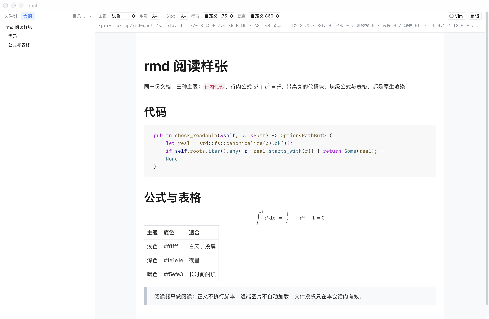
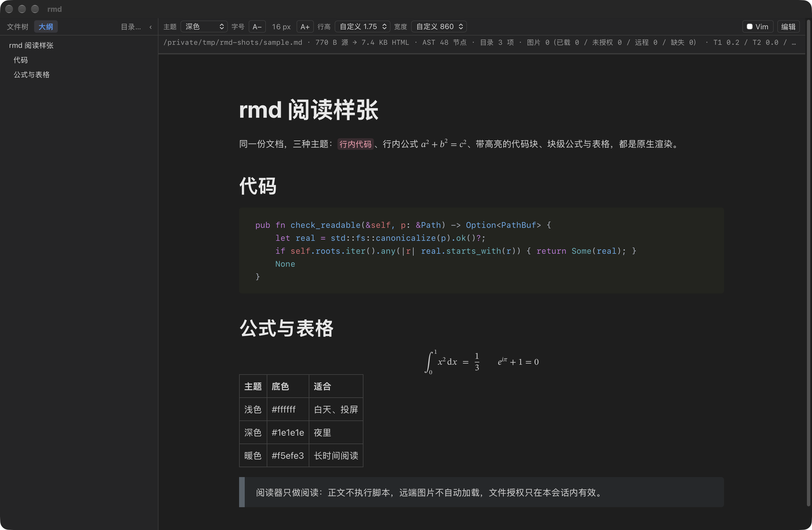
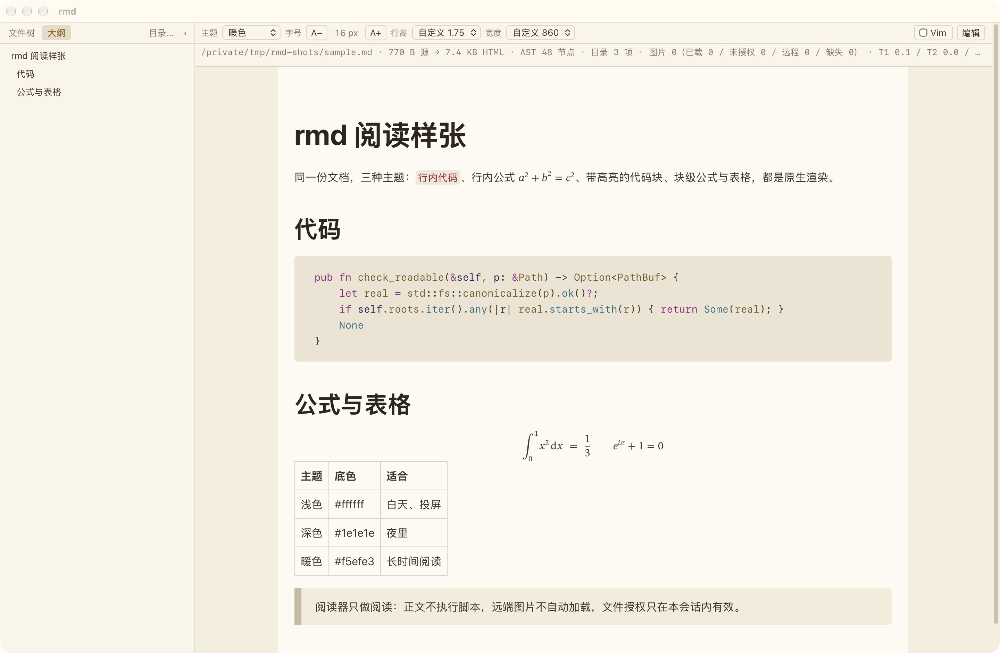

# rmd — a Markdown reader for large documents and local folders

Browse, search, and read source repositories, project documentation, and local Markdown collections on macOS.
Find files across folders, navigate long documents, and resume reading where you left off.

[中文说明](README.zh-CN.md) · [Download](https://github.com/kumustone/rmd/releases/latest) · [Changelog](CHANGELOG.md) · [Build from source](BUILDING.md)

**Requires macOS 13+ and Apple Silicon.**

> This README describes the current development branch. The document list, empty-folder filtering,
> configurable folder exclusions, and sidebar search are development features. Check the corresponding
> [release notes](https://github.com/kumustone/rmd/releases/latest) for the features in the download.

[](assets/screenshots/theme-light.png)

## Features

### Reading and navigating large documents

- Read technical documentation with syntax highlighting, math, diagrams, and tables.
- Jump between sections using the outline, or use `⌘F` to search the current document's rendered text.
- Resume at your saved reading position when you reopen a document.
- Adjust font size, line height, and content width. Choose light, dark, warm, or system-following themes.

Stage-by-stage measurements cover generated documents of roughly **100 KB–10 MB**, including prose,
headings, code, and tables. See [Performance](#performance).

### Browsing large folders (development)

- The **file tree** loads directory levels on demand for browsing project structure.
- The **document list** brings indexed Markdown files from the folder and its subfolders into one view,
  with parent paths to distinguish files with the same name.
- Rows are appended in batches, up to **5,000**. If more files are indexed, the list shows the displayed
  and total counts; filename search remains available to locate other documents.
- Reopening a folder restores the last document and tree expansion state. Switching between tree and
  list views keeps the current document open.

### Folder filtering (development)

- Hide files and folders whose names start with a dot.
- Default exclusions such as `node_modules`, `target`, `dist`, and `build` appear dimmed and are not
  scanned. The exclusion list can be changed in the configuration file.
- Hide folders whose subtrees contain no Markdown documents according to the index, keeping the
  branches that lead to documents.
- Keep incompletely scanned subtrees visible; the document list reports incomplete indexing.

Filtering reduces navigation clutter without moving or deleting files on disk.

### Fast filename search

- Use `⌘P` to find files in the current folder and its subfolders without expanding each directory.
- Fuzzy matching helps locate a file by name; select a result to open it.
- The development version also has a persistent sidebar search box backed by the same index as `⌘P`.
- The index includes `.md` files. Filename search and searching within the current document have
  separate controls.

## Install and get started

### Download the app

Download the `.dmg` from [Releases](https://github.com/kumustone/rmd/releases/latest), then drag
`rmd.app` into `/Applications`. Checksums and version-specific changes are on the same release page.

The current build is ad-hoc signed and has not been notarized by Apple. If macOS blocks it, first try
opening the app, then go to **System Settings → Privacy & Security → Open Anyway** and follow the
system prompts. See [Apple's instructions](https://support.apple.com/en-us/102445).

### Browse and read

1. Open a folder with `⌘O`, or a single Markdown file with `⇧⌘O`.
2. Browse the file tree. In the development version, use the file-panel toggle to switch to the document list.
3. Find a document by filename with `⌘P`, then navigate its content using the outline and `⌘F`.

### Open files from the terminal

In the app, choose **rmd → Install Command Line Tool…** and select a location:

- `~/.local/bin`: no administrator permission required. If it is not on `PATH`, the app provides setup instructions.
- `/usr/local/bin`: installation requires administrator authorization.

The app checks whether the command is available after installation. It does not modify your shell
configuration; the same menu provides an uninstall action.

```bash
rmd README.md     # Open a file
rmd ./docs        # Open a folder
```

The command links to the executable inside the app. Replacing the app at the same path preserves the
link; moving the app requires reinstalling the command.

<details>
<summary>Install the command-line link manually</summary>

This example assumes `/Applications/rmd.app`. Adjust the target if the app is installed elsewhere.

```bash
mkdir -p "$HOME/.local/bin"
ln -s /Applications/rmd.app/Contents/MacOS/rmd "$HOME/.local/bin/rmd"
export PATH="$HOME/.local/bin:$PATH"
```

The `export` applies to the current terminal only. Configure `PATH` for your shell to make it persistent.
If a command already exists at that location, use the app menu to manage it.
</details>

For dependencies, source builds, and app packaging, see [BUILDING.md](BUILDING.md).

## Performance

Measured on an **Apple M2 Pro with 16 GB RAM, macOS 27.0**, using release builds. All figures below
are medians, measured on 2026-10-24.

| Scenario | Result | Scope |
|---|---:|---|
| Build an index of 100,000 `.md` files in 201 folders | 122 ms | Backend index construction |
| Query an existing 100,000-entry index, high hit rate | 48–54 ms | Backend matching, sorting, and result truncation |
| List 100,000 entries in one folder | 354 ms | Backend scanning, filtering, and sorting |
| Append the first 500 document-list rows | 12–13 ms | Offscreen DOM construction and layout |
| Complete appending 5,000 document-list rows | 113 ms | Offscreen DOM construction and layout |

The first query also pays the index-build cost. These figures exclude IPC, real-window compositing,
and first paint, so they are not complete file-open or input-response timings. Full methodology,
large-document stage timings, and reproduction steps are in the [performance documentation](assets/performance/).
The folder, list, and search baselines describe the development branch; version scope is recorded there.

## Reading settings and optional editing

rmd is designed primarily for reading. To change the current document, explicitly enter split-view
editing: Markdown source on the left and a rendered preview on the right, with optional Vim keybindings.
You can also open the document in an external editor; rmd reloads it when it changes on disk.
The interface supports Chinese and English.

<details>
<summary>View the light, dark, and warm themes</summary>

The same document in three themes. Font size, line height, and content width are independently adjustable.

| Light | Dark | Warm |
| :---: | :---: | :---: |
| [](assets/screenshots/theme-light.png) | [](assets/screenshots/theme-dark.png) | [](assets/screenshots/theme-warm.png) |

</details>

## Keyboard shortcuts

| Action | Shortcut |
|---|---|
| Open folder / open file | `⌘O` / `⇧⌘O` |
| Quick open by filename | `⌘P` |
| Refresh file index | `⌘R` |
| Search the current document's rendered text | `⌘F` |
| Show or hide sidebar / top bar | `⌘B` / `⇧⌘B` |
| Settings | `⌘,` |
| Open in external editor | `⇧⌘E` |
| Toggle split-view editing | `⌘E` |

The complete shortcut list is in Settings. Custom keybindings are not currently supported.

## Local files and privacy

Documents stay in local folders, with no import step, account, telemetry, or cloud synchronization.
File reads follow the permissions granted for files and folders. Document scripts are not executed;
external links open in the system browser. See [SECURITY.md](SECURITY.md) for security details and reporting.

## Building and contributing

rmd uses Rust, Tauri 2, and the system WKWebView, without bundling a separate browser engine. The UI
uses plain JavaScript, with CodeMirror 6 for split-view editing. Running the app does not require Node.js.

- [Build from source](BUILDING.md)
- [Contributing](CONTRIBUTING.md)
- [GPL-3.0-or-later license](LICENSE)
- [Third-party components and licenses](THIRD-PARTY-NOTICES.md)
