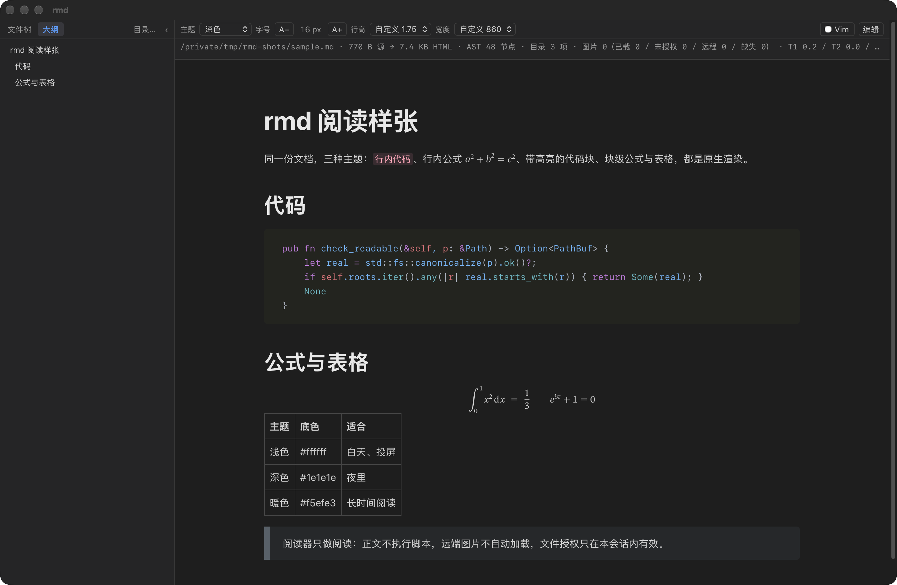
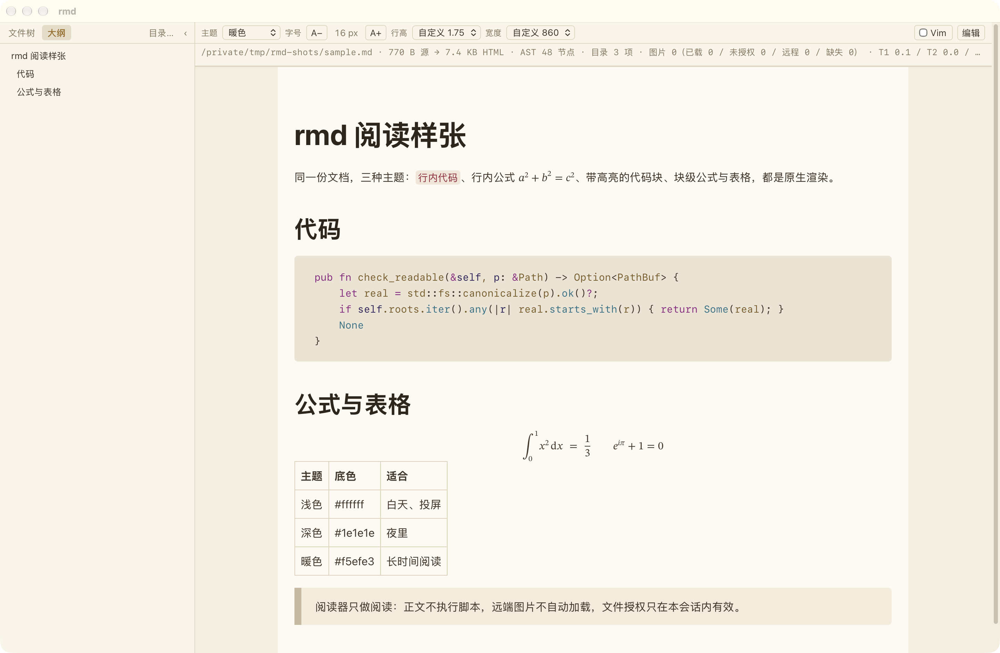

# rmd — 面向大文档与本地目录的 Markdown 阅读与编辑工作空间

在 macOS 上阅读、检索、编辑并导出 Markdown——面向源码仓库、文档树，以及那些在浏览器标签页里很慢、
当成纯文本又读不下去的长文。

[English](README.md) · [下载](https://github.com/kumustone/rmd/releases/latest) · [更新记录](CHANGELOG.md) · [从源码构建](BUILDING.md)

**系统要求：macOS 13+，Apple Silicon。**

[](assets/screenshots/theme-light.png)

## 为什么用它

**整个目录，一次检索。** 打开目录时只为目录下所有 Markdown 文件建**一份**文件名索引：
10 万份文件、201 个目录建索引 **122 ms**，命中数万条时查询 **48–54 ms**。`⌘P` 查的就是这份索引，
不需要逐层展开目录。

**阅读与编辑是同一面。** 点段落、列表、表格单元格或代码块，编辑框就出现在该块原来的位置上；
离开后这一块回到渲染态。两态画在同一套排版尺度上——标题字色、块间距、列表标记出自同一处定义，
而不是另做一套近似渲染。本版的就地编辑仍需手动开启，见[启用就地编辑](#启用就地编辑)。

**文档先渲染，再进页面。** 代码高亮、数学公式（MathML）和 Mermaid 图表都在 Rust 侧生成，
产物还要按白名单重建一遍。文档里的脚本不会执行，也不会为了画一张图往 WebView 里加载第三方 JavaScript。

**文件留在原处。** 没有账号、没有导入、没有云同步、没有遥测。读盘权限来自你当次授予的目录或文件。

**读文档才是大头，于是「接着上次读」被做成一键。** 在一个代码库里，大部分时间花在读 README、
设计说明和排查记录上，而不是写代码。rmd 把空白页做成一个能直接干活的导航页：`⌘L` 从任何文档回到它，
新建文档、打开、最近目录与收藏都在这一页，各带快捷键。`⌘D` 把常看的那份钉在页面上，
关掉文档也不会丢掉阅读历史。

## 功能一览

一句话：浏览并检索一个 Markdown 目录，用为中文长文做过取舍的排版去读，就地改或改源码，再把结果导出成
HTML 或 PDF。下面按能力分类列出**今天已经支持什么**，也把不支持的写在明处。

### 导航页

`⌘L` 从任何文档回到导航页。它不是一块占位空白：新建文档（`⌘N`）、打开（`⌘O`）、最近目录、收藏
都在这一页，各带快捷键，继续昨天没读完的那份只要一个键，不用先翻文件对话框。`⌘D` 收藏当前文档，
`⌘[` 沿阅读历史往回走。

### Markdown 支持度

| 语法与渲染 | 支持 | 说明 |
|---|:---:|---|
| CommonMark：标题、强调、链接、图片、列表、引用、分隔线、代码 | ✅ | |
| GFM 表格 | ✅ | 单元格内可用 `<br>` 换行 |
| GFM 任务列表 | ✅ | 阅读态可直接勾选 |
| 删除线、自动链接、脚注 | ✅ | |
| 围栏代码块与语法高亮 | ✅ | 高亮有预算；超出的块以完整纯文本显示，并在状态条计数 |
| 数学公式 `$…$`、`$$…$$` | ✅ | 渲染为 MathML |
| Mermaid 图 | ✅ | 12 种：流程图、时序图、类图、状态图、ER 图、饼图、思维导图、旅程图、gitGraph、时间线、桑基图、架构图；其余图种回退为代码块并给出可见原因 |
| 标题锚点与文内跳转 | ✅ | |
| 指向其他 Markdown 文件的相对链接 | ✅ | 在 rmd 内打开，与侧边栏同一套权限校验 |
| 图片预览与缩放 | ✅ | |
| YAML frontmatter | ❌ | 不解析，按正文显示 |
| GitHub 告警块 `> [!NOTE]` | ❌ | 按普通引用显示 |
| 内嵌 HTML 与脚本 | ❌ | 丢弃、不执行；表格单元格内的 `<br>` 是唯一例外 |

### 阅读

| 能力 | 支持 |
|---|:---:|
| 侧边栏大纲视图 | ✅ |
| 正文内查找（`⌘F`，`⌘G` / `⇧⌘G`） | ✅ |
| 按文档记住阅读位置 | ✅ |
| 字号、行高、内容宽度 | ✅ |
| 浅色、深色、暖色与跟随系统主题 | ✅ |
| 图片缩放预览层 | ✅ |

### 编辑

本版的就地编辑需手动开启，见[启用就地编辑](#启用就地编辑)；分栏编辑开箱可用。

| 能力 | 就地编辑 | 分栏编辑 |
|---|:---:|:---:|
| 段落、标题、列表、引用、代码块 | ✅ | ✅ |
| 表格单元格 | ✅ | ✅ |
| 任务项复选框，点击切换 | ✅ | — |
| 浮动格式栏（标题、链接、表格行列） | ✅ | — |
| 在源码里替换（`⌥⌘F`） | — | ✅ |
| Vim 键位 | — | ✅ |
| 撤销 / 重做 | ✅ | ✅ |
| 输入法组合串不跳 | ✅ | ✅ |
| `⌘S` 写盘 | ✅ | ✅ |
| 外部编辑器（`⇧⌘E`）与磁盘变化自动重载 | ✅ | ✅ |

离开一个块后改动即进入当前文档，`⌘S` 才写进文件。

- `⌘↵` 在当前块之后新建段落，而不是退出编辑；`Tab` / `⇧Tab` 逐级降级、升级列表项，子树跟随父项移动。
- `⌘N` 立即新建一份未命名文档，第一次保存时才询问位置。
- 实测渲染耗时过高的文件会暂停自动重载，提示条改为提供「立即重载」，不静默刷新。

### 目录、检索与导航

| 能力 | 支持 |
|---|:---:|
| 文件树，按层加载目录 | ✅ |
| 平铺文档列表，显示父路径 | ✅ |
| 文档列表 5,000 行上限，如实显示已显示条数与总数 | ✅ |
| `⌘P` 在整个目录树上模糊检索文件名 | ✅ |
| 侧边栏常驻文件名搜索框 | ✅ |
| `⌘R` 重建文件名索引 | ✅ |
| 隐藏点文件；忽略目录清单可配置 | ✅ |
| 隐藏子树中没有 Markdown 的目录 | ✅ |
| 无法完整扫描的子树保守保留并如实提示 | ✅ |
| 导航页：新建、最近、收藏（`⌘L`） | ✅ |
| 收藏文档或目录（`⌘D`） | ✅ |
| 文档前进 / 后退（`⌘[` / `⌘]`，鼠标侧键） | ✅ |
| 把文件或目录拖到窗口上打开 | ✅ |
| 在 Finder 中显示 | ✅ |

### 导出与 macOS 集成

| 能力 | 支持 |
|---|:---:|
| 保存为 HTML（`⇧⌘S`） | ✅ |
| 导出为 PDF（`⇧⌘P`） | ✅ |
| 复制为 Markdown / HTML / 纯文本 / 富文本 | ✅ |
| 字面粘贴（`⇧⌘L`） | ✅ |
| 原生窗口标签（`⌘T`）与多窗口（`⇧⌘N`） | ✅ |
| 应用内安装命令行工具（`rmd file.md`、`rmd ./docs`） | ✅ |
| 从终端或 Dock 打开时窗口到前台 | ✅ |
| 中文与英文界面 | ✅ |

## 安装与快速开始

### 下载

从 [Releases](https://github.com/kumustone/rmd/releases/latest) 下载 `.dmg`，打开后将 `rmd.app`
拖入 `/Applications`。校验值与该版本的更新说明位于同一 Release 页面。

当前安装包使用本地签名（ad-hoc），尚未经过 Apple 公证。如果 macOS 阻止打开，先尝试启动应用，
再进入「系统设置 → 隐私与安全性 → 仍要打开」，按照系统提示确认。
参见 [Apple 的打开应用说明](https://support.apple.com/zh-cn/102445)。

### 浏览与阅读

1. `⌘O` 打开面板（第一屏是最近，下面才是浏览目录／浏览文件），`⇧⌘O` 直接打开单个 Markdown 文件。
2. 文件面板可在文件树与文档列表之间切换，用 `⌘P` 按文件名直接跳转。
3. 用大纲和 `⌘F` 在文档内导航。

### 从终端打开

打开应用菜单「rmd → 安装命令行工具…」，选择安装位置：

- `~/.local/bin`：无需管理员权限；若未加入 `PATH`，应用会提供配置说明。
- `/usr/local/bin`：安装时需要管理员授权。

安装完成后，应用会检测命令是否可用。它不会修改 shell 配置；卸载入口位于同一菜单。

```bash
rmd README.md     # 打开一个文件
rmd ./docs        # 打开一个目录
```

命令链接指向应用内的可执行文件。在相同路径替换新版应用后链接仍然有效；移动应用后需重新安装命令。

<details>
<summary>手动安装命令行入口</summary>

以下示例对应 `/Applications/rmd.app`。如安装在其他位置，请调整目标路径。

```bash
mkdir -p "$HOME/.local/bin"
ln -s /Applications/rmd.app/Contents/MacOS/rmd "$HOME/.local/bin/rmd"
export PATH="$HOME/.local/bin:$PATH"
```

`export` 仅影响当前终端；持久生效需按所用 shell 配置 `PATH`。已有同名入口时，可通过应用菜单管理。
</details>

从源码构建的依赖、命令和应用打包步骤见 [BUILDING.md](BUILDING.md)。

## 启用就地编辑

就地编辑是一条全新的输入路径，所以目前仍用开关控制。在配置文件里加一个键并重启 rmd：

```json
{
  "live_edit": true
}
```

文件位于 `~/Library/Application Support/io.github.kumustone.rmd/config.json`。文件已存在就把这个键加进
原有对象，不要整份覆盖；不存在才按上面内容新建。改完重启 rmd。
不带这个键时阅读态保持原样，`⌘E` 仍进入分栏编辑。

## 性能基线

在 **Apple M2 Pro、16 GB 内存、macOS 27.0** 上测量，release 构建，2026-10-24。
以下均为中位数；每一行都标注了测量范围，且都不是「按键到画面」的计时。

| 场景 | 测量结果 | 范围 |
|---|---:|---|
| 构建 10 万份 `.md` 的索引（201 个目录） | 122 ms | 后端索引构建 |
| 查询已建立的 10 万条索引，高命中率 | 48–54 ms | 后端匹配、排序与结果截断 |
| 列出单目录的 10 万项 | 354 ms | 后端扫描、过滤与排序 |
| 文档列表首批 500 行 | 12–13 ms | 离屏 DOM 构造与布局 |
| 文档列表 5,000 行追加完成 | 113 ms | 离屏 DOM 构造与布局 |

首次查询还需承担索引构建成本。上述数字不包含 IPC、真实窗口合成与首帧绘制。

文档管线分阶段读数（只在 Rust 侧，约 10.5 MB 的生成文件）：

| 阶段 | 纯正文 | 表格密集 |
|---|---:|---:|
| 读盘并校验 UTF-8 | 8.8 ms | 9.6 ms |
| comrak 解析 | 11.0 ms | 109.2 ms |
| 渲染 HTML（高亮、公式、图表） | 3.8 ms | 65.7 ms |

这些是**同一条管线**的各阶段，**不能相加当作打开时间**：应用的打开路径还包含 IPC、WebView 解析、
布局与首帧绘制。代码密集的 10 MB 文件渲染耗时 **402 ms**，原因是高亮在预算处停止，
而不是「高亮变便宜了」——25,310 个代码块中 2,973 个高亮，其余 22,337 个以完整转义纯文本显示。
完整环境、全部 17 份语料与复现方法见[性能文档](assets/performance/)。

## 快捷键

| 文件与窗口 | 快捷键 |
|---|---|
| 打开… | `⌘O` |
| 打开文件… | `⇧⌘O` |
| 新建文件… | `⌘N` |
| 保存 | `⌘S` |
| 按文件名搜索… | `⌘P` |
| 刷新文件名索引 | `⌘R` |
| 用外部编辑器打开 | `⇧⌘E` |
| 保存为 HTML… | `⇧⌘S` |
| 导出为 PDF… | `⇧⌘P` |
| 新建窗口 | `⇧⌘N` |
| 新建标签页 | `⌘T` |

| 阅读与导航 | 快捷键 |
|---|---|
| 回到导航页 | `⌘L` |
| 后退 / 前进（文档） | `⌘[` / `⌘]` |
| 收藏 / 取消收藏 | `⌘D` |

| 查找 | 快捷键 |
|---|---|
| 查找… | `⌘F` |
| 查找替换… | `⌥⌘F` |
| 查找下一个 / 上一个 | `⌘G` / `⇧⌘G` |

| 编辑 | 快捷键 |
|---|---|
| 进入 / 退出编辑（分栏） | `⌘E` |
| 在块后新建段落（就地编辑） | `⌘↵` |
| 全选正文 | `⌘A` |
| 撤销 / 重做 | `⌘Z` / `⇧⌘Z` |
| 复制为 Markdown | `⇧⌘M` |
| 复制为 HTML 源码 | `⇧⌘K` |
| 复制为纯文本 | `⌥⌘P` |
| 复制为富文本 | `⇧⌘R` |
| 粘贴为字面 Markdown 源码 | `⇧⌘L` |

| 视图 | 快捷键 |
|---|---|
| 显示/隐藏侧边栏 | `⌘B` |
| 显示/隐藏顶栏 | `⇧⌘B` |
| 放大 / 缩小 / 复位字号 | `⌘=` / `⌘-` / `⌘0` |
| 行号 | `⌃⌘L` |
| 专注模式 | `⌃⌘Z` |
| 放大 / 缩小 / 实际大小 | `⌃⌘=` / `⌃⌘-` / `⌃⌘0` |
| 设置… | `⌘,` |

设置里显示的也是这份列表，且由后端同一张表生成；暂不支持自定义键位。

## 设置与主题

字号、行高、内容宽度、主题与界面语言都在设置中调整。

<details>
<summary>查看浅色、深色与暖色主题</summary>

同一份文档在三套主题下的阅读效果。浅色、深色、暖色都独立于系统外观；第四种是跟随系统。

| 浅色 | 深色 | 暖色 |
| :---: | :---: | :---: |
| [](assets/screenshots/theme-light.png) | [](assets/screenshots/theme-dark.png) | [](assets/screenshots/theme-warm.png) |

</details>

## 本地文件与隐私

文档直接保存在本地目录，无需导入或注册账号，也没有遥测或云同步。
文件读取遵循用户授权的文件与目录范围；文档脚本不执行，外部链接交给系统浏览器打开。
安全说明与漏洞报告渠道见 [SECURITY.md](SECURITY.md)。

## 它不是什么

rmd 不是知识库、笔记系统或同步客户端。它不维护第二份笔记副本，不管理账号，
也不修改你没有打开过的文件。它是一扇朝向某个 Markdown 目录的窗口，带的编辑能力刚好够你在窗口里继续工作。

## 构建与参与

rmd 使用 Rust、Tauri 2 和系统 WKWebView，不附带独立浏览器内核。前端使用原生 JavaScript，
分栏编辑基于 CodeMirror 6。运行应用不需要 Node.js。

- [架构说明](ARCHITECTURE.md)
- [从源码构建](BUILDING.md)
- [贡献指南](CONTRIBUTING.md)
- [GPL-3.0-or-later 许可证](LICENSE)
- [第三方组件与许可证](THIRD-PARTY-NOTICES.md)
